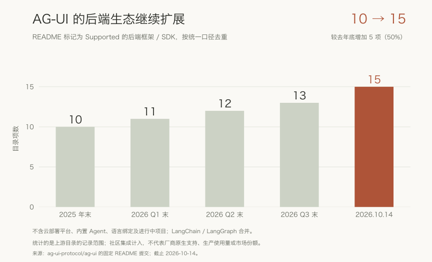

最近做一个 Agent 项目，ChatGPT 给我推荐了 CopilotKit 和 AG-UI。用到项目里之后，我才开始关注它们背后的公司和生态。

起初关心的是项目怎么做。顺着资料往下看，问题渐渐变了：为什么这么多 Agent 框架愿意接入同一个协议？推动它的公司，又想走到哪里？

微软的 Agent Framework、Google ADK、AWS AgentCore，还有 LangChain、Pydantic AI、Agno，都能找到 AG-UI 的接入资料。前端一侧，assistant-ui、OpenUI 也在使用它。后端各有主张，界面各有选择，却在交互方式上出现了共同需求。

CopilotKit 的发展轨迹也让我想到 LangChain：从一个开发者工具出发，随着使用者遇到更多问题，逐渐扩展出新的工具、合作和平台产品。我看好它成为 Agent 交互领域重要平台公司的潜力，理由就在这两条线索里。

*本文资料截至 2026 年 10 月 14 日。*

## 一家从应用里走出来的公司

CopilotKit 的联合创始人 Atai Barkai 和 Uli Barkai 是两兄弟。他们最初做 AI 播客产品 tawkitAI，将内部基础设施开源后，发现开发者对这套工具很感兴趣，便转向了 [Copilot 开发工具](https://www.geekwire.com/2026/seattles-copilotkit-raises-27m-as-some-of-the-biggest-names-in-tech-adopt-its-ai-agent-protocol/)。

2026 年 5 月，公司披露合计 2700 万美元融资，包含 A 轮和早期种子轮，投资者包括 Glilot、NFX、SignalFire。Glilot 在[投资文章](https://glilotcapital.com/cyberhubs/why-we-led-copilotkits-27m-series-a-building-the-user-interface-layer-for-the-agentic-era/)中称，早期企业产品已有付费客户，收入也在增长，但没有披露具体金额。

它的产品方向很集中：围绕人与 Agent 的交互，提供前端 SDK、运行时连接、持久化和渠道服务。AG-UI 将其中的通信需求抽成开放协议，约定 Agent 怎样把消息、工具行为、状态和运行信息交给用户侧应用。

## Agent 开始工作，人还在场

假设在一套费用系统里，用户请 Agent 检查一笔重复扣款。它查订单、核合同，再提出退款或抵扣建议。模型和工具配合得好，这条链路或许已经能跑通。

对着页面的人，还需要知道查询到了哪一步、Agent 准备修改哪笔记录，以及自己是否该批准。如果金额需要改，修改后能不能继续？如果查错了对象，又在哪里把它叫停？

用户与 Agent 有时看着同一份数据，有时轮流修改同一个状态。产品得让人看懂它正在做什么，也得让人的决定进入后续执行。

长任务、异步事件、审批，都有很长的软件工程历史。Agent 把它们更密集地放到一次交互里：执行路径会变，工具调用与自然语言交错，中途还可能回来问人一句。后端框架各有各的事件格式，应用开发者得把这些差异翻译成可以使用的界面。

麻烦还会随着选择增加。后端换一个框架，进度、工具卡片和审批逻辑可能又要适配；增加移动端或者协作软件入口，类似的工作还会再来一遍。

这些工作经常被归到“前端还要接一下”。但每增加一种后端、一个客户端，都要重新处理一遍，就说明其中有值得复用的部分。

## AG-UI: 让后端与界面各自演进

AG-UI 在做的，就是为这层交互提供共同表达。流式传输负责把数据送过来，应用还得知道：这是一段回答，还是一次工具调用？是状态发生了变化，还是执行暂停、需要用户补充输入？

共同语义让应用有机会复用事件处理和交互逻辑。[1.0 规范](https://docs.ag-ui.com/spec/1.0)进一步明确了结构、顺序、生命周期和兼容行为。后端可以继续选择模型和框架，客户端围绕共同契约建设体验；能复用多少，取决于两边共同支持的能力。

人也不会在按下发送之后就离开。审核、修改、接管，都需要在执行过程中发生。AG-UI 提供交互表达，应用和运行时负责权限、持久状态与实际执行。这种分工让客户端与后端可以更独立地演进，也让开发者有机会保留已经做好的产品体验。

MCP 主要连接工具与数据，A2A 连接 Agent，AG-UI 面向用户应用；A2UI 关注界面如何被声明和渲染，Google 已经[说明了与 AG-UI 的组合方式](https://developers.googleblog.com/a2ui-v0-9-generative-ui/)。这些协议在职责上可以互补，在具体产品选型中也会重叠。

与 AG-UI 最值得直接比较的是 ACP（Agent Client Protocol）。它同样将 Agent 与客户端解耦，覆盖会话、流式更新、工具调用和权限请求。

ACP 从编辑器与编码 Agent 的集成出发，通过双向 JSON-RPC 方法和通知组织交互，客户端还能按能力提供文件读写、终端等宿主资源。客户端也可以是其他 UI，使用范围不限于 IDE。[ACP 官方介绍](https://agentclientprotocol.com/get-started/introduction)、[协议概览](https://agentclientprotocol.com/protocol/v1/overview)

AG-UI 侧重运行输入与类型化事件流。两者起点不同，交互能力却明显重叠。在我看来，AG-UI 能否成为常用协议，需要放进具体场景里比较：哪套契约更容易接入，哪些行为能被不同实现稳定地理解。

*图 1：五种协议的连接对象与侧重。ACP 指 Agent Client Protocol；它与 AG-UI 都连接客户端和 Agent，能力存在重叠。*

## 朋友圈扩大之后

AG-UI 的生态究竟扩大了多少？我回看了仓库 README 的历史提交，按同一口径做了五次快照统计。

标记为 Supported 的后端框架／SDK，在 2025 年底已有 10 项；今年一季度末为 11 项，二季度末 12 项，三季度末 13 项，到 10 月 14 日为 15 项。与去年底相比，增加了 5 项。

*图 2：五个固定版本 README 中的后端覆盖记录。合并 LangChain／LangGraph，排除云平台、语言绑定、内置与进行中项目，社区集成计入。目录数量不代表生产使用量；固定提交与完整口径见[数据说明](assets/README.md)。*

新增记录包括 Langroid、Claude Agent SDK、Claude Managed Agents SDK、Google Antigravity 和 Cloudflare Agents。目录更新可能晚于实际发布，各项集成的维护方式也不同；它能说明覆盖范围在扩展，尚不能说明真实使用规模。

今年的公开进展，还显示出参与方式的变化：

| 2026 年节点 | 公开进展 | 我的观察 |
| --- | --- | --- |
| 3 月 13 日 | [AWS AgentCore Runtime 支持 AG-UI](https://aws.amazon.com/about-aws/whats-new/2026/03/amazon-bedrock-agentcore-runtime-ag-ui-protocol/) | 协议进入云运行基础设施的支持范围 |
| 4 月 17 日 | [Google A2UI v0.9 展示经 AG-UI 连接不同框架](https://developers.googleblog.com/a2ui-v0-9-generative-ui/) | 交互契约与生成式 UI 表达继续组合 |
| 8 月 18／24 日 | [CrewAI](https://www.copilotkit.ai/blog/crewai-is-fully-agui-compatible)、[Mastra](https://www.copilotkit.ai/blog/mastra-agui-compatible) 适配更新 | 已有连接还在补充更丰富的交互能力 |
| 9 月 18 日 | [AG-UI 1.0 正式发布并冻结](https://github.com/ag-ui-protocol/ag-ui/discussions/2792) | 第三方有了更稳定的独立实现依据 |
| 9 月 25 日 | [官方介绍微软贡献的第一方 .NET SDK](https://www.copilotkit.ai/blog/agui-dotnet-sdk) | 外部参与者开始贡献协议本身的 SDK |

从云平台接入、框架适配到 SDK 贡献，外部参与者承担的工作在变多。[Microsoft](https://learn.microsoft.com/en-us/agent-framework/integrations/ag-ui/)、[Google ADK](https://adk.dev/integrations/ag-ui/)、[LangChain](https://docs.langchain.com/oss/python/deepagents/ag-ui)、[Pydantic AI](https://pydantic.dev/docs/ai/integrations/ui/ag-ui) 和 [Agno](https://docs.agno.com/agent-os/interfaces/ag-ui/introduction) 自己的文档，也都有专门的接入说明。

我尤其在意前端的变化。[assistant-ui](https://www.assistant-ui.com/docs/runtimes/ag-ui/overview)提供了自己的 AG-UI runtime，[Mastra 的教程](https://mastra.ai/integrations/agentic-ui/openui)则展示如何通过 AG-UI 接入 OpenUI。第三方愿意围绕它建设客户端，意味着协议已经能服务于发起方产品之外的需求。

我看好这种分工的接受度。框架厂商可以保留编排和运行能力，同时接触更多客户端；应用团队保留自己的界面，也多了选择后端的余地。双方都有继续维护共同接口的理由。

## CopilotKit: 一个 SDK，慢慢长成一套工具

协议生态扩大，让更多后端与客户端彼此连接。CopilotKit 自己的产品生态，则关系到开发者接触它以后，还会留下来做什么。

现在已有 React、Vue、Angular 和 React Native 四类 SDK／绑定。7 月 23 日的 [Angular 公告](https://www.copilotkit.ai/blog/copilotkit-for-angular)里，Soverius AI 与 CopilotKit 合作维护绑定，代码直接进入上游仓库。外部团队承担持续维护，生态便多了一种扩展方式。[Vue 文档](https://docs.copilotkit.ai/reference/vue)中也能看到针对框架使用习惯的设计。

*图 3：截至 2026 年 10 月的 CopilotKit 产品范围。各项能力成熟度不同，其中 CLiF 的产品操作轨迹仍处于 early access。*

这些扩展也能从今年的产品公告中看到：

| 时间 | 产品节点 | 延伸到哪里 |
| --- | --- | --- |
| 5 月 14 日 | [Enterprise Intelligence 平台介绍](https://www.copilotkit.ai/blog/copilotkit-enterprise-intelligence-platform) | 持久线程与生产基础设施 |
| 7 月 23 日 | Angular 绑定协作维护公告 | 更多前端开发者与外部维护者 |
| 8 月 4 日 | [Channels SDK](https://www.copilotkit.ai/blog/channels-sdk) | 首先支持 Slack、Teams 协作渠道 |
| 8 月 19 日 | [React Native SDK 公告](https://www.copilotkit.ai/blog/react-native-your-agent-inside-your-mobile-app) | iOS、Android 原生应用界面 |
| 9 月 3／10 日 | [WebMCP 接入](https://www.copilotkit.ai/blog/introducing-webmcp-for-copilotkit)、[Inspector 更新](https://www.copilotkit.ai/blog/inspector-upgrades) | 工具发现与开发调试 |
| 10 月 9／13 日 | [Open Intelligent UI](https://www.copilotkit.ai/blog/introducing-open-intelligent-ui)、CLiF 公告 | 开源应用与反馈学习 |

*表中日期是对应的公开介绍或更新节点，不统一视为能力第一次出现的日期。*

CLI、Inspector 和用于 AI 服务模拟、故障注入的 [aimock](https://www.copilotkit.ai/blog/aimock-model-misbehavior)，分别覆盖搭建、调试与测试；[OpenBot](https://www.copilotkit.ai/openbot)等开源应用，则将底层能力组合成可直接使用的产品。开发者从一个 SDK 进入，随后遇到的工作，也开始有相应的工具承接。

截至 10 月 14 日，CopilotKit 主仓库有 38,003 个 stars，AG-UI 仓库为 16,513。这是两个项目的关注度快照，不能相加当成独立用户数。对公司的长期价值而言，更关键的是这些关注能否带来维护者、可用集成，以及愿意持续使用产品的团队。[CopilotKit 仓库](https://github.com/CopilotKit/CopilotKit)、[AG-UI 仓库](https://github.com/ag-ui-protocol/ag-ui)

## 让我想到 LangChain 的，是这条来路

LangChain 起初也只是一个 SDK。Harrison Chase 在 2022 年秋天发布了一个 Python 开源包，那时还没有公司。工具让人很快做出原型，也连接了越来越多的模型、检索和数据服务。等开发者开始认真使用它，原型后面的难题便陆续出现：出了错怎么查，改了提示词怎么测，长任务又该怎样运行？

2023 年 7 月 18 日，[LangSmith 以 closed beta 发布](https://www.langchain.com/blog/announcing-langsmith)，面向调试、测试、评估和监控；2024 年 1 月 17 日，[LangGraph 的发布介绍](https://www.langchain.com/blog/langgraph)把工具范围推向更可控的 Agent 工作流；同年 6 月，[LangGraph Cloud](https://www.langchain.com/blog/langgraph-cloud)又把部署与运行纳入进来。

这些产品沿着使用者的需求连了起来：先把原型做出来，再找到错误、验证修改，最后部署并持续运行。LangChain 逐渐覆盖了这些环节，公司也超出了最初那个 SDK 的边界。

CopilotKit 给我的感觉与此相似。2024 年 7 月的 [v1.0 公告](https://www.copilotkit.ai/blog/copilotkit-v1-launch)，重点是 React SDK hooks、生成式 UI 与运行时连接；2025 年 5 月发起 AG-UI 后，连接范围扩大到多个 Agent 后端；到了今年，多端 SDK、协作渠道、生产平台和学习产品又渐渐铺开。

两家的顺序并不一样。LangSmith 早于 LangGraph，CopilotKit 在 2024 年 v1 公告里也已有 Cloud beta。我想到的相似，是它们都从开发者愿意使用的工具出发，随着需求增加，持续扩大产品与业务范围。

*图 4：两家公司分别按时间排序的发展节点。相似的是扩展路径，不表示产品逐项对应或增长速度相同。*

Harrison 在[三年回顾](https://www.langchain.com/blog/three-years-langchain)中解释，LangSmith 从一开始就希望服务不同框架的开发者。这一步很关键：公司可以通过自己的 SDK 获得最初的用户，也能凭生产工具服务更广的开发者。

CopilotKit 也在面对这一步。保存交互、管理线程、把 Agent 放进 Slack 和 Teams，都有上线后长期存在的运营工作。[Channels 产品页](https://www.copilotkit.ai/channels)划分了用户部署的 Agent、应用里的连接层，以及 Intelligence 承担的渠道基础设施；[定价页](https://www.copilotkit.ai/pricing)也已经有开发者、Pro、Team 和企业计划。

开发者觉得好用，与企业愿意采购，中间还隔着不少问题。数据留在哪里，故障之后如何恢复，运营工作由谁承担，自行维护与购买服务哪个更合适，都得逐一回答。公司能否将生态位置变成生意，往往就落在这些具体事情上。

## 用户留下的那一半经验

10 月 13 日，CopilotKit 发布 CLiF，尝试将 Agent 执行轨迹与用户操作整理成可复用的改进材料。

按照 [发布说明](https://www.copilotkit.ai/blog/introducing-clif)，基于 Agent 轨迹的学习当前可用，产品操作轨迹仍处于 early access。它会提出供人审阅的技能建议，并向评估、训练材料和更完整的改进周期延伸。

考虑一个场景：Agent 完成了一份费用报告，用户改了分类，删掉一段说明，又手工补上一个步骤。只看 Agent 端的轨迹，未必能理解后面的操作；只看页面被改过，也不能轻易判断是 Agent 做错了，还是用户有自己的偏好。

将两侧放在一起，才有机会看清哪些工作总要由人补一遍，哪些要求反复被提出，以及哪些步骤可以整理成经验。

*图 5：两侧轨迹如何进入技能建议与人工审阅。产品操作轨迹仍为 early access，评估与训练材料为延伸方向；此图不代表已实测的自动优化效果。*

这个方向吸引我的地方，是人的纠正有机会被保留下来。如果技能确实有效，用户就能少交代几次同样的要求，团队也多了一批来自实际任务的评估案例。

一次特殊处理，也可能被误学成所有任务的新规则。因此，建议是否改善了目标任务、是否带来其他回归，以及人能否理解和撤回变更，都需要验证。CLiF 要证明的价值，最终在这些改进的质量里。

CLiF 强调自托管和产物可导出。客户数据不会因为采用这套交互层，就自然成为公司的共享资产；竞争优势仍需靠采集质量、分析效果和工作流整合建立。

而 LangSmith Engine 已经在分析生产轨迹、发现问题和提出修复；2026 年 9 月发布的 [v2](https://www.langchain.com/blog/langsmith-engine-v2-redteam)，又扩展了部分自动测试与验证能力，其中一些仍处于 Private Beta。于是 LangChain 同时成了 CopilotKit 的合作伙伴、来路的参照，以及相邻领域的竞争者。

这让 CopilotKit 需要回答一个更具体的问题：用户的修改、审批和接管，能为 Agent 改进补充多少后端轨迹里缺少的信息？

## 开放之后，生意从哪里来

AG-UI 的开放性有利于生态扩展，也给 CopilotKit 留下了商业难题。

其他前端可以使用协议，企业可以自建服务，云平台也可以提供运行基础设施。某个用户完全可能大量使用 AG-UI，却没有购买 CopilotKit 的商业产品。协议让公司有机会被发现，合同与续费还得由产品自己赢下来。

生态的可靠性也要在细节中积累。[Agno 9 月 23 日的更新](https://www.agno.com/articles/the-ag-ui-interface-supports-ag-ui-protocol-1-0)披露，工具结果扩展为内容片段列表后，旧恢复代码仍期待字符串，一度导致审批失败。修复以后，适配层提取文本，对图像等其他片段忽略并告警。能正常聊天、能恢复审批、能无损传递多模态内容，是不同层次的兼容。

有了稳定规范，后面的迁移、测试和协调仍要有人来做。关键变更怎样决定，第三方的反馈能否进入规范，公共契约与商业产品的需求如何取舍，也都会影响这个生态的长期吸引力。

另一边，[Thoughtworks 的技术雷达](https://www.thoughtworks.com/en-br/radar/platforms/ag-ui-protocol)在 2026 年 4 月将 AG-UI 列入 Trial，认可它的解耦价值，也提醒团队留意 MCP 生态中把界面与工具一起交付的路线。给现有 AI 宿主增加交互式工具，与为自己的业务软件建设 Agent 界面，未必需要同一套答案。

我接下来会看三件事：Intelligence 是否进入客户的核心流程，独立实现能否更稳定地协作，以及选择其他前端的团队是否仍愿意购买它的平台服务。这些信号，比下一轮开源热度更接近公司的长期价值。

所以，对标题里的问题，我的回答是：有机会，而且已经有了一些值得看好的条件。共同交互需求足够具体，AG-UI 有跨框架响应，CopilotKit 也在从 SDK 延伸到生产和改进工具。至于能否达到 LangChain 的商业规模，还要看这些产品能否留住客户，带来持续收入。

我最初只是为项目找一套方案，后来才顺着它看见这条成长路径。它也是我对 CopilotKit 最感兴趣的地方：开发者从一个工具进入，走向生产时遇到的新问题，公司能不能继续接住。
