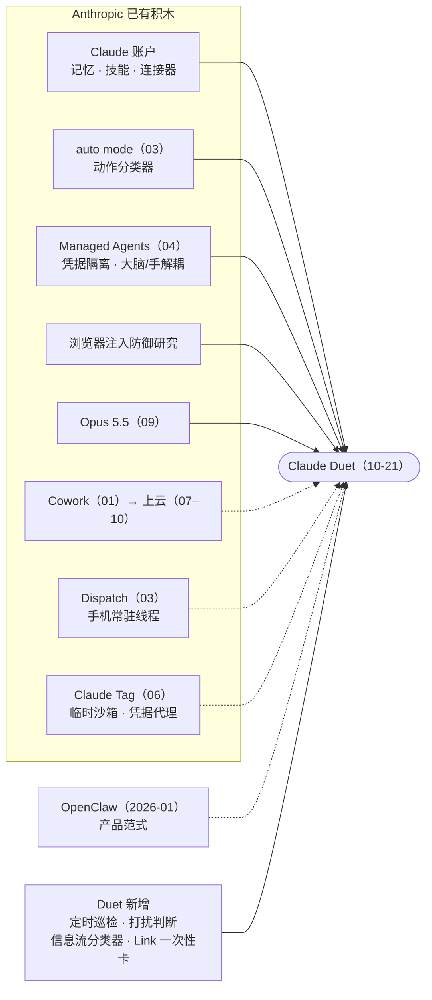

> [!tip]
> 一句话判断：Claude Duet = 常驻云端 VM 的 Opus 5.5、每几小时一次的巡检，加一层「什么事值得打扰你」的判断器。引擎并不新——云端执行、凭据隔离、动作分类器、注入防御，都是 Anthropic 过去九个月陆续上线的积木；Duet 真正新加的，是巡检节奏、外发信息分类器和一次性虚拟卡支付。它押的不是功能广度，而是判断力和安全默认值；代价是小时级延迟、看不到浏览器，以及只对美国 Pro / Max 用户开放。

2026 年 10 月 21 日，Anthropic 发布 Claude Duet 的研究预览：一个独立 App（iOS / Android）加 claude.ai，不等你开口，会自己看邮件、盯账户、做调研、起草 deck，在要发信、要花钱、要删东西之前停下来问你[1](https://claude.com/resources/articles/claude-duet)[2](https://www.cnbc.com/2026/10/21/anthropic-preview-of-claude-duet-personal-ai-agent-take-on-muse-dots.html)。发布时机挑在 Meta 财报日，媒体当天就把它定性为对 Meta Muse 和 OpenAI Dots 的回应[3](https://www.businessinsider.com/anthropic-answers-meta-openai-new-personal-agent-claude-duet-2026-10)。

这篇文章做三件事：拆清楚 Duet 到底由什么拼成；把它和 Dots、Muse、Grok Bot、Manus Cue 放在一张桌上比；以及回答我最好奇的问题——常驻个人 Agent 这个形态 OpenClaw 年初就跑通了，大厂为什么直到现在才出手。

文中事实分三档：官方文档或官网写明的给引用编号，我自己的工程判断标明「判断」，不确定的放进文末的存疑清单。资料核对至 2026 年 10 月 26 日。

## 先看清它是什么

形态上，Duet 是一条主线程加若干主题频道。早上它给你一份晨报，白天每隔几小时巡检一遍已连接的账户，任务在云端 VM 里跑，手机和电脑关机都不影响；主线程只给你推两类消息：「做完了」和「需要你定」[1](https://claude.com/resources/articles/claude-duet)[4](https://support.claude.com/en/articles/17631495-get-started-with-claude-duet)。你可以按招聘、融资、新店这类主题开频道，频道之间共享同一份记忆。

*官网演示三屏。左：晨报，每条挂一个频道标签（招聘、客户续约、新店、融资、客诉），橙色手形图标表示需要你处理。中：Series A 频道，deck 作为 Make 工件交付，并列着数据室还缺的三份文件。右：一句话生成的「Marlo Pulse」经营看板，数据来自 POS、Shopify、CRM、客服邮箱、工资单和银行。底部三个页签：Chat、Tasks、Make。来源：[Claude Duet 产品页](https://claude.com/product/claude-duet)。*

官方对它的用户画像是专业人士和小企业主：招聘、融资、开新店、催款、发工资[1](https://claude.com/resources/articles/claude-duet)。负责人 Karan Ahuja 七月前还在 Meta 超级智能实验室做产品管理，八月加入 Anthropic 牵头 Duet[3](https://www.businessinsider.com/anthropic-answers-meta-openai-new-personal-agent-claude-duet-2026-10)。官网的对比一句话讲完定位：Claude App 等你开口，Duet 主动来找你[5](https://claude.com/product/claude-duet)。

商业上，研究预览期含在 Pro（20 美元/月）和 Max（100 美元/月起）里，不另收费，但和其他 Claude 产品共享 5 小时及每周额度——晨报和后台巡检按普通聊天同样的速率计数，大任务吃得更快[4](https://support.claude.com/en/articles/17631495-get-started-with-claude-duet)。据获邀用户的开通引导，入选还送一次完整额度重置，2026 年 11 月 30 日前有效；这条没有写进任何公开官方页面，只能算社区佐证[65](https://www.reddit.com/r/ClaudeAI/comments/1xdhrmj/free_reset_with_claude_duet)。可得性目前是三个限定：仅美国、仅 Pro / Max、仅等候名单分波放量；Team / Enterprise 官方说「以后会有」但没有时间表，没有 Duet API，Mac app 在做[4](https://support.claude.com/en/articles/17631495-get-started-with-claude-duet)[6](https://venturebeat.com/technology/anthropics-answer-to-muse-is-here-claude-duet-a-mobile-and-desktop-ai-agent-that-takes-actions-proactively)[10](https://x.com/ahuja_karan/status/2113768265562620109)。

功能边界我整理成一张表：

| 模块 | 能做什么 | 关键边界 |
| --- | --- | --- |
| 主线程 + 频道 | 打字或发语音；按主题开频道，频道间共享记忆 | 主线程只收「完成」和「要你决定」两类消息 |
| 晨报 + 巡检 | 早上看邮件日历挑要紧事并起草第一步；白天每几小时检查账户、跟进沉默线程 | 固定间隔轮询，急事可能落在两次检查之间；关注对象和频率可配置 |
| 大任务 + Make | 研究简报、财务模型、deck、看板、Web app，自决用什么应用、花多少 effort | 大任务吃更多模型轮次，额度消耗更快 |
| Tasks | 跟踪进行中的事，标出需要你输入的 | 它可以提示「看起来做完了」，只有你能标记完成 |
| 连接器 | 继承账户记忆、技能、连接器，Marketplace 6,000+ 插件（Gmail、Slack、QuickBooks、Stripe、Gusto、Shopify 等） | Slack 功能受限，Microsoft 365 暂不支持；断开应用只停后续访问，旧记忆仍保留 |
| 云 VM + 浏览器 | 没有连接器的网站用自带云端浏览器操作，关机照常干活 | 你看不到也接管不了这个浏览器；网站密码走设备端独立表单直达浏览器 |
| 审批 | 发送、付款、签署、删除前完整展示，等你批准；你没空它先做其余部分 | 证券交易、账户间转账、访问他人账户，批准了也不做 |
| 支付 | Link 确认花费后发一次性虚拟卡，也支持 Shop Pay | 只在 Duet 内可用；配送退货找商家，选错东西找 Anthropic |
| 历史检索 | 搜过去的 Duet 对话和项目之外的 Claude 对话 | 受 Search and reference chats 开关控制，只读不能改 |
| 通信 | 经你批准用已连接账户发邮件 | 不打电话，也不给别人发短信 |

## 技术拆解：没有新原语，只有两处新东西

从 Agent 工程的角度先给总判断：Duet 没有发明新的运行时原语。循环跑在 Managed Agents 式的无状态 harness 上，状态在会话日志里，手是按需拉起的云 VM，护栏是几类分类器加人审。真正新的只有两处——调度节奏（几小时一次，外加「要不要打扰你」的判断），和信息流审查（外发消息逐条检查）。

下面这个交互图把晨报巡检、大任务、付款三个场景里一次唤醒依次经过哪些组件画了出来，每一步都标了证据来源（文档 / 官网演示 / 文档+判断 / 纯判断），可以播放或逐步看：

<figure class="html-embed">
  <iframe src="/embeds/2026-10-26-claude-duet/duet_runtime.html" title="Claude Duet 一次唤醒经过的组件：晨报巡检、大任务、付款三个场景" loading="lazy" data-html-embed="true"></iframe>
  <figcaption>交互图：三个场景里，一次唤醒依次经过哪些组件。每步标注来源类型。</figcaption>
</figure>

### 运行时：大脑无状态，手按需拉起

官方文档说，Duet 有自己的 VM 和浏览器，不需要你的手机或电脑开着；凭据处理沿用 Managed Agents 的设计[1](https://claude.com/resources/articles/claude-duet)。Managed Agents 今年四月的重构把一个 Agent 拆成三件：Session 是只追加的事件日志，Harness 是无状态的循环，Sandbox 是执行环境，接口收敛到 execute、wake、getSession、emitEvent 四个；大脑和手解耦之后，p50 首 token 延迟降了约 60%，p95 降了 90% 以上[8](https://www.anthropic.com/engineering/managed-agents)。

我的判断：Duet 的每次巡检就是一次 wake——harness 读会话日志、调连接器，只有要开浏览器或动文件时才拉起 VM，用完即停。几小时才醒一次的负载，为它常驻一台机器不划算，而 Managed Agents 那篇文章开篇就叫「Don't adopt a pet」，本就是为大部分时间在睡的 Agent 设计的。

*Managed Agents 的五个组件彼此只通过稳定接口通信。Duet 官方称凭据处理沿用这套设计。来源：[Scaling Managed Agents](https://www.anthropic.com/engineering/managed-agents)。*

收益是关机照常干活、容器挂了也不丢状态；代价是执行面完全在平台侧，你看不到也接管不了浏览器[4](https://support.claude.com/en/articles/17631495-get-started-with-claude-duet)——而 Grok Bot 允许用户随时接管它那台 microVM[15](https://docs.x.ai/grok-bot/computer-and-apps)。对照 OpenClaw，后者是一个常驻 Gateway 进程统管所有渠道，跑在你自己的机器上，机器一关就停[16](https://docs.openclaw.ai/concepts/architecture.md)。

### 状态：会话不是上下文窗口

一条主线程可以无限长，靠的是另一个老设计。Managed Agents 里有一章标题就叫「The session is not Claude's context window」：会话日志是外部持久对象，harness 每轮按需取片段塞进上下文[8](https://www.anthropic.com/engineering/managed-agents)。所以「快速回复和一周的项目都从同一个地方开始」[1](https://claude.com/resources/articles/claude-duet)并不魔法——频道是给人看的分区，不是给模型的隔离，它们共享记忆正好说明上下文是每轮重新组装的。它给出的数字和摘要会注明出自哪封邮件、哪个文件、哪张表[4](https://support.claude.com/en/articles/17631495-get-started-with-claude-duet)，这意味着检索层保留了来源 ID——对审计和纠错都很关键。

记忆的托管方式也和 OpenClaw 形成对比：OpenClaw 的记忆是工作区里的 Markdown 文件，Agent 自己写、用户自己维护[17](https://docs.openclaw.ai/concepts/memory)；Duet 的记忆由平台托管，断开连接器后旧记忆仍然保留，用户可以随时在设置里 reset memory，删号则全部清除[4](https://support.claude.com/en/articles/17631495-get-started-with-claude-duet)[7](https://claude.com/resources/articles/claude-duet-safety-privacy-and-security)，能直接控制的范围更小。

### 主动性：定时巡检加一个打扰判断层，第一批实测说了什么

每天早上一份晨报；白天每隔几小时检查一次已连接账户。原文给出的理由很实在：「持续检查会更快耗尽套餐额度」；关注什么、多久报一次，可以自己告诉它[1](https://claude.com/resources/articles/claude-duet)。

官方把 Duet 最有用的能力称为判断力——决定哪些事要找你、哪些可以等、什么时候先问你[1](https://claude.com/resources/articles/claude-duet)；Mike Krieger 的说法是「知道什么时候该主动、什么时候该替你动手」[3](https://www.businessinsider.com/anthropic-answers-meta-openai-new-personal-agent-claude-duet-2026-10)。他们同时承认它可能读错线程、误判轻重缓急，打扰的时机还在按测试者反馈调[1](https://claude.com/resources/articles/claude-duet)。

两个判断：

- 「几小时」首先是个成本参数，不是技术上限。Duet 用的是轮询，至少公开材料里没有事件推送或 webhook，延迟按小时计，换来可预测的额度消耗。对照看，OpenClaw 早期的 heartbeat 周期唤醒现在已经降级为普通 automation job[18](https://docs.openclaw.ai/heartbeat)；Grok Bot 的 routine 最短间隔是 5 分钟[19](https://docs.x.ai/grok-bot/skills-routines-and-automations)。
- 分诊本质是给每条信号做四分类：要你 / 可以等 / 先动手 / 先问你。真正难的是推送阈值：打扰太多会被关通知，太少等于没用。这是 Duet 唯一全新的一层，也恰恰是最难评估的一层——没有任何公开的准确率数据。

没有数据，但发布日就有了第一批实测。Anthropic 给了少数作者提前访问：Every.to 的 Dan Shipper 用了两周，称它是第一个达到「pro tool」级别的个人 Agent，主动把他下一步要做的事都做了[22](https://every.to/vibe-check/vibe-check-duet-anthropic-s-always-on-agent)；产品人 Claire Vo 在 Lenny's Newsletter 的实测标题却是《Claude Duet is beautiful. I still forgot to use it》——她测了收件箱、Slack、销售管线、幻灯片和找球票，结论是不够主动、有延迟、没有桌面端、不能多人协作，「漂亮，但我还是忘了用它」[23](https://www.lennysnewsletter.com/p/claude-duet-is-beautiful-i-still)[24](https://www.geekpark.net/news/372740)。10 月 23 日起，普通入组用户的体验视频和 Reddit 讨论也开始出现，评价同样两极。样本都很小，但至少说明一件事：这个产品真正的分水岭不在功能清单，而在那个推送阈值调得准不准。

### 工具与凭据：连接器优先，浏览器兜底，外加一套 Agent 门禁

有连接器走连接器（6,000+），没有就开云端浏览器[1](https://claude.com/resources/articles/claude-duet)[4](https://support.claude.com/en/articles/17631495-get-started-with-claude-duet)。10 月 23 日的官方安全长文补充了关键的隔离细节：浏览器跑在一台独立的云端 VM 上，和模型、agent 工作机都分开；agent 只能用 open / click / type 这一组固定指令驱动它，网站代码、cookies、下载留在浏览器机，只有页面文本和下载文件回到模型，任何指令都读不出 cookies[7](https://claude.com/resources/articles/claude-duet-safety-privacy-and-security)。

凭据不进模型，这条链路在 Managed Agents 里是：git 令牌初始化时接好，MCP 的 OAuth 令牌放进保险库、经专用代理调用，harness 本身不知道任何凭据[8](https://www.anthropic.com/engineering/managed-agents)。到了 Duet，网站密码由你在设备上的独立表单输入，用一次性密钥加密、不拆封直达浏览器 VM，模型不经过手；登录表单永远不会以链接、短信、邮件或 claude.ai 以外的网站形式出现——这本身就是一个钓鱼防御设计。1Password 登录官方仍写「即将支持」[7](https://claude.com/resources/articles/claude-duet-safety-privacy-and-security)。

*Claude Tag 的请求路径。这套「凭据不进沙箱、代理按规则注入」的设计是 Duet 凭据处理的近亲。来源：[Claude Tag Docs｜Security and data](https://claude.com/docs/claude-tag/concepts/security-and-data)。*

还有一层以前没人披露过：Duet 的浏览器请求带独立 User-Agent，Anthropic 公开它的出口 IP，上线前主动联系几家大网站给了屏蔽选项，「有些网站选择屏蔽」[7](https://claude.com/resources/articles/claude-duet-safety-privacy-and-security)。这等于官方自己承认了第六节会讲到的平台门禁问题——网站愿不愿意让 agent 进门。

### 安全栈：三类分类器、人审和硬禁区

10 月 23 日，Anthropic 如约发布 12 分钟的安全长文《Claude Duet Safety, Privacy, and Security》[7](https://claude.com/resources/articles/claude-duet-safety-privacy-and-security)。Duet 遵循的可信 Agent 框架也指导 Claude Code 与 Claude in Chrome[1](https://claude.com/resources/articles/claude-duet)[20](https://www.anthropic.com/research/trustworthy-agents)；拆开是六层：

| 层 | 防什么 | 机制 | 公开数据 |
| --- | --- | --- | --- |
| 输入 | 邮件、网页里藏的指令 | 强化训练模型把不可信内容当信息；分类器扫描进入上下文的不可信内容 | Opus 4.5 加改进护栏后，自适应攻击者每环境试 100 次成功率 1.4%（2025 年 11 月研究，N=2,782）；Opus 5.5 比 Opus 5 更抗注入 |
| 动作 | 你没让它做的步骤 | 每个动作旁挂一个独立于干活模型的外置分类器（auto mode 分类器的 Duet 扩展版）：单 token 快筛，被标记才跑思维链；页面里藏的指令影响不到它 | Claude Code 真实流量误拦 0.4%；真实越界动作漏放 17%，合成外泄漏放 5.7% |
| 信息流（新） | 把信息发到不该去的地方 | 独立分类器逐条检查外发消息，分两级：登录凭据、完整卡号、银行账号、证件号「永不外发，即使用户要求」；健康、财务信息需明确同意；被拦可自动脱敏改写后再交你批 | 无量化数据，官方承认偶尔会漏判或误拦 |
| 人审 | 不可逆动作 | 发送、付款、签署、删除前展示动作、目标和完整内容（含每个收件人），等你批准；付款、汇出钱、删订单、建账号永远不能选「以后别问我」 | — |
| 硬禁区 | 最高风险类别 | 证券交易、账户间转账等银行动作、访问他人账户，批准了也不做 | — |
| 外部 | 基础设施漏洞 | 红队、带源码的外部渗透测试（浏览器和登录表单的二期测试进行中）、HackerOne 公开赏金 | — |

*auto mode 的系统结构：每个工具调用先过转录分类器；工具结果由服务端注入探针；派子 Agent 时进出各过一次交接分类器。Duet 的动作审批复用并扩展了这个分类器。来源：[How we built Claude Code auto mode](https://www.anthropic.com/engineering/claude-code-auto-mode)。*

三条判断：

- 分类器是用来减少审批疲劳的，不是安全边界。Claude Code 用户本来就会批准 93% 的弹窗[11](https://www.anthropic.com/engineering/claude-code-auto-mode)，而 17% 的漏放率说明它替代不了人审——所以 Duet 把不可逆动作留给人，把最危险的类别直接禁掉。安全长文里也专门讨论了审批疲劳：请求太多会训练用户无脑点通过，校准仍在继续[7](https://claude.com/resources/articles/claude-duet-safety-privacy-and-security)。
- 最值得抄的设计是 reasoning-blind：审查器跑在干活的模型外面，看不到模型的自我辩解和工具输出，被注入的内容既影响不了判定，也很难反过来「说服」审查器[7](https://claude.com/resources/articles/claude-duet-safety-privacy-and-security)[11](https://www.anthropic.com/engineering/claude-code-auto-mode)。
- 信息流分类器是 Personal Agent 特有的一层。Coding Agent 的风险主要是做了不该做的事；替你读邮件、发消息的 Agent，风险是把 A 的信息发给 B——比如把你的绩效面谈写进给团队的周报[7](https://claude.com/resources/articles/claude-duet-safety-privacy-and-security)。

### 审批与支付：把不可逆动作做成卡片

*左：开业清单频道，41 项里 33 项完成或正常推进、7 项在盯、1 项要你处理；640 美元卫生许可费的审批卡写明金额、用途和「8 分钟后过期」。右：给投资人的邮件，收件人、主题、正文全部展开，确认后才显示 Sent。来源：[Claude Duet 产品页](https://claude.com/product/claude-duet)。*

异步审批：你一时没空，它先把其余部分做完，审批稍后带回来[4](https://support.claude.com/en/articles/17631495-get-started-with-claude-duet)。注意演示里那张审批卡自带过期时间（8 分钟）——审批是一等状态，不是卡住整个任务的弹窗。Grok Bot 来自 routine 和触发器的审批大约 10 分钟过期[21](https://docs.x.ai/grok-bot/approvals-security-and-privacy)，量级相近。

支付走两道确认：Duet 先和你确认买什么，Link 再请你批准花多少，然后发一张只对这一笔、这一个商家有效额的虚拟卡，真实卡号既不给 Duet 也不给商家；也支持 Shop Pay[1](https://claude.com/resources/articles/claude-duet)[4](https://support.claude.com/en/articles/17631495-get-started-with-claude-duet)。Link 帮助页还划了硬边界：只支持美区支付方式，可能产生临时预授权，不支持定期付款，Duet 只能看到卡组织、尾号、昵称、有效期和收货地址；Link 和 Shop Pay 只能在 Duet 里连接，Claude、Cowork、Claude Code 都用不了[25](https://support.claude.com/en/articles/17666484-how-to-use-link-by-stripe-with-claude-duet)。责任边界也是第一次被写进帮助文档：订单、配送、退货找商家；Link 扣款找 Link；Duet 选错了商品、商家或选项，找 Anthropic[4](https://support.claude.com/en/articles/17631495-get-started-with-claude-duet)。两个独立系统各审一次，Agent 即使被注入也很难单方面把钱花出去。

### 模型：不可选，自己决定花多少 effort

Duet 只跑 Opus 5.5，用户不能换；每项工作花多少 effort 由它自己决定[4](https://support.claude.com/en/articles/17631495-get-started-with-claude-duet)。Opus 5.5（9 月 22 日发布）的卖点恰好是克制：自动行为审计成绩最好，更少做难以撤销的动作、更少越界，比 Opus 5 更抗注入，Gray Swan 测试中和 Claude Fable 5.1 并列攻击成功率最低[14](https://www.anthropic.com/claude-opus-5-5)。

对常驻 Agent，克制比聪明值钱——一次越界的代价远高于一次答错。effort 自决则把成本控制交给模型：巡检用低 effort 快速分诊，大任务再加码（判断）。

## 五款个人 Agent 放在一张桌上

按 2026 年 10 月下旬的公开功能：

| | Claude Duet | ChatGPT Dots | Meta Muse | Manus Cue | Grok Bot |
| --- | --- | --- | --- | --- | --- |
| 组织形态 | 单一助理：主线程+主题频道 | 目前一个 dot+后台 agents | 单一助理：主聊天+side chats | 多个有身份的 agent 同频道接力，邀请制[35](https://manus.im/blog/introducing-manus-2-0)[37](https://pandaily.com/manus-2-0-cascade-agent-harness-cue-personal-agents) | 花名册式多 Bot+上级 Bot，2–6 个可组群聊[64](https://docs.x.ai/grok-bot/chat-and-collaboration) |
| 云电脑 | 云 VM+独立浏览器机，不能看不能接管 | 每个 dot 一台云电脑，可连本地电脑 | Meta 云上 Secure VM | 每个 agent 一台 | 每用户 1 台 microVM，可随时接管 |
| 身份 | 用你已连接的账户行事 | 以你的账号行事 | 名字、头像、风格 | 邮箱、手机号、钱包 | Bot 档案；一个全 Bot 共用的专属邮箱[34](https://cursor.com/help/grok-bot/agent-email) |
| 主动性 | 晨报+几小时巡检+打扰判断 | 主动调研，可自主暂停/醒来 | 提醒、目标、后台监控 | Routines（定时/事件） | 主动提议+routine（≥5 分钟）+事件触发 |
| 安全 | 注入+动作+信息流三类分类器，人审，硬禁区 | 内置规则+Custom Rules+Activity View | Sentinel 读写分级+独立监控 agent | 分 agent 权限+钱包预算 | Auto Review 审阅模型 |
| 模型 | Opus 5.5，不可选 | GPT-6 Astra | Muse Spark | Cascade harness | 自动路由不可选，池含 xAI 与第三方模型[33](https://cursor.com/help/grok-bot/models) |
| 入口 | 独立 App+claude.ai | ChatGPT、Slack、Teams | App、WhatsApp、网页 | App、Apple Messages、电话 | App、Slack、X |
| 价格 | 含在 Pro 20 美元 / Max 100 美元起 | 个人最低 100 美元 | 免费（有用量上限） | 内测免费；出现过 Plus 20 美元/月标签（未官宣）[36](https://help.manus.im/en/articles/17190150-what-is-new-in-manus-2-0) | 不单卖，X Premium 30 美元/月起附赠[32](https://x.ai/news/x-subscription) |
| 强项（判断） | 判断力与安全默认值、小企业 SaaS | 模型与插件生态 | 分发规模、消费级安全 | 现实世界行动 | 团队协作、编码委派 |

顺带回答一个被反复讨论的子问题：这五家里只有 Grok Bot 和 Cue 支持创建多个长期 Bot 并让它们群聊协作；Duet 的频道、Muse 的 side chats、Dots 的一人一个 dot 都不算多 Bot——Dots 官方把多 dot 列为未来功能，企业侧的 specialist dots 已在定向试点，还要接入 Microsoft Agent 365[26](https://openai.com/index/introducing-dots)[27](https://help.openai.com/en/articles/20001530-getting-started-with-your-dot)。

**两派分野很清楚：Duet、Muse、Dots 是「单助理、多会话」，你经营的是和一个助理的长期关系；Grok Bot、Cue 是「多 Bot 团队」，你管理一组有名字、有分工、会互相交接的长期 Bot。**

Duet 最像 Muse（判断）：一条主线加话题分区、上下文互通——Duet 频道共享记忆[4](https://support.claude.com/en/articles/17631495-get-started-with-claude-duet)，Muse 在主聊天和 side chats 之间保持上下文[30](https://www.meta.com/help/artificial-intelligence/1331373868832401/)；继承账户记忆、接手长期工作又像 Dots。定位偏工作，可以叫它「工作版 Muse」。单助理阵营也在往多实例走，只是办法是对外一个出口、内部并行（Dots 的后台 agents[28](https://learn.chatgpt.com/docs/dots/getting-started)），而不是给用户一张 Bot 花名册。

Duet 的优势，我看四条：安全默认值最完整且每层都有公开工程文章可查；门槛低到 20 美元的 Pro（Dots 最低 100，Grok Bot 要 30 美元起的 X 订阅，只有 Muse 免费）；冷启动快，记忆、技能、连接器、历史对话直接继承；面向工作，QuickBooks、Gusto、Stripe、Shopify 加上 Make 里可编辑的成品。

短板同样清楚：小时级轮询不是事件驱动，急事可能漏掉；浏览器不能看也不能接管，出错难复盘；没有多 Agent 花名册，没有专属邮箱手机号；订票这类个人事务官方明说还不够强[1](https://claude.com/resources/articles/claude-duet)；只在自己的 App 里，进不了 Slack、WhatsApp；可得性窄到美国 Pro / Max 等候名单。VentureBeat 还点了一个产品缺口：没有任务级的成本预估[6](https://venturebeat.com/technology/anthropics-answer-to-muse-is-here-claude-duet-a-mobile-and-desktop-ai-agent-that-takes-actions-proactively)。

**这个赛道按周在变。** 截稿前的最后一周：Muse 被确认上线 40 天全球下载 1,090 万次、美国 1,020 万次，成为史上第 12 个 40 天内美国破千万的 App（Sensor Tower 口径）[38](https://techcrunch.com/2026/10/20/metas-muse-hits-10m-u-s-downloads-in-40-days-a-milestone-reached-by-only-11-other-apps)；Meta 财报则披露美加约 1,000 万人已设置 Muse、约四分之一日活、购物平均客单价超过 200 美元，Stripe 还为此提高了对 Meta 的信用额度[39](https://www.cnbc.com/2026/10/22/meta-muse-personal-ai-agents.html)。Grok Bot 这边 10 月 23 日发布 v0.75.5（Vault 凭据库、routine 频次上限提到每小时 300 次），22 日 Grok Bot 还开放了手机日历、提醒、联系人和智能家居的本地集成[41](https://www.digitaltrends.com/phones/grok-bot-can-now-manage-your-calendar-reminders-and-more)，25 日马斯克又预告它能替你给商家打电话、记笔记、回传摘要——Duet 明说「不打电话」，这条边界正在被对手踩过去[40](https://x.ai/changelog/bot)。10 月 22 日，1Password 宣布向 Muse、Dots、Grok 开放凭据能力，Duet 尚未在首批名单里[42](https://www.engadget.com/2293844/1password-opens-up-ai-agents-muse-dots-grok)。

## OpenClaw 火了九个月，大厂为什么现在才出

我的结论：晚的不是想法，是可托管。

OpenClaw 证明了需求，但把最难的部分甩给了用户：自己的机器、自己的 API Key、自己的安全。大厂要把它做成默认安全、能定价、能规模化的产品，得先过五道闸门。闸门决定能不能发，竞争决定什么时候发。

*实线：官方明确沿用的组件；虚线：形态相近、我推断的演进关系或范式影响。*

<figure class="html-embed">
  <iframe src="/embeds/2026-10-26-claude-duet/why_late.html" title="2026 年 1–10 月五条泳道关键事件交互时间线" loading="lazy" data-html-embed="true"></iframe>
  <figcaption>交互时间线：五条泳道上的关键事件，点圆点看事件和出处；浅色区间是 8 月 11 日到 10 月 21 日扎堆发布的十周。</figcaption>
</figure>

**第一道，安全：先把暴露面收回来。** 这里要分清三家不同口径的数据，它们经常被混引：Censys 观测到公网可访问的 OpenClaw 实例在不到一周里从约 1,000 涨到 21,000+（截至 1 月 31 日，Acronis 报告转述）[47](https://www.acronis.com/en/tru/posts/openclaw-agentic-ai-in-the-wild-architecture-adoption-and-emerging-security-risks/)；SecurityScorecard 2 月 9 日在 42,900 个暴露面板里发现约 15,200 个可被远程利用；Koi Security 研究员 2 月 1 日审计全部 2,857 个 ClawHub 技能，发现 341 个恶意，其中 335 个来自 ClawHavoc 一次协同行动[48](https://scmagazine.com/news/openclaw-agents-targeted-with-341-malicious-clawhub-skills)；CVE-2026-25253 能从网关令牌外泄串到一键 RCE[49](https://github.com/openclaw/openclaw/security/advisories/GHSA-g8p2-7wf7-98mq)；Moltbook 数据库一次暴露约 150 万个 API 密钥[51](https://www.wiz.io/blog/exposed-moltbook-database-reveals-millions-of-api-keys)；到 3 月 RSAC 期间，Censys 口径的实例数已接近 50 万，且没有企业 kill switch（数据截至 3 月 24 日）[50](https://venturebeat.com/security/openclaw-500000-instances-no-enterprise-kill-switch)；凭据明文存放、执行工具前没有显式授权，是当时审计反复点名的架构问题[52](https://thehackernews.com/2026/02/openclaw-integrates-virustotal-scanning.html)。这些数字是不同日期的快照，不能互相加减，但方向一致。同期 Anthropic 依次交付了 auto mode（3 月）、凭据移出沙箱（4 月）、信息流分类器（10 月）。大厂没法发一个默认带着这些问题的产品。

**第二道，经济：常驻会打穿订阅，而定价至今没完全落定。** 4 月 4 日 Anthropic 禁止用订阅 OAuth 驱动 OpenClaw 等第三方 agent，Boris Cherny 给出的理由是这类用法绕开了 prompt cache，「really hard to do sustainably」[43](https://venturebeat.com/technology/anthropic-reinstates-openclaw-and-third-party-agent-usage-on-claude-subscriptions-with-a-catch)。5 月 13 日 Anthropic 宣布新的 Agent SDK 额度池：独立计量、月底不结转、超额按 API 价；封禁原定 6 月 15 日新计费生效时解除——但 6 月 15 日当天 Anthropic 暂停了这套改动，第三方应用至今继续走普通订阅额度，10 月 7 日起才又给 Max / Team 另发了可用于 Agent SDK 的每月 Console API 额度[43](https://venturebeat.com/technology/anthropic-reinstates-openclaw-and-third-party-agent-usage-on-claude-subscriptions-with-a-catch)。所以「常驻怎么收费」没有一锤定音的答案。需求端的账也不好看：OpenClaw 作者 Peter Steinberger 10 月 21 日在 Cloudflare Connect 自称上个月烧掉约 1,000 万美元 token（本人自述，无账单佐证）[53](https://thenextweb.com/news/openclaw-steinberger-10m-tokens-cloudflare-connect)；大摩 Brian Nowak 团队 9 月底的报告把 Muse 的单位经济列为核心问题，测算单用户月服务成本约 3 到 130 美元，取决于用量，而真正的 agent 变现将近 2027 年底才会到来[66](https://thedarksideoftheboom.substack.com/p/morgan-stanley-meta-has-built-the)。Duet 给出的是另一种解法：不做持续在线，把巡检间隔本身变成产品参数，后台检查计入现有额度[1](https://claude.com/resources/articles/claude-duet)[4](https://support.claude.com/en/articles/17631495-get-started-with-claude-duet)。

**第三道，模型：没人盯着也得守规矩。** Anthropic 自己写过，最初把大脑放在单个容器里，是因为早期模型还不会在多个执行环境之间推理、决定把活派到哪里[8](https://www.anthropic.com/engineering/managed-agents)；Business Insider 的说法是，最近的模型突破让 AI 更能独立干活，才引发这波常驻 Agent 热[3](https://www.businessinsider.com/anthropic-answers-meta-openai-new-personal-agent-claude-duet-2026-10)。即便如此，1% 量级的注入成功率官方仍称为「有意义的风险」[12](https://www.anthropic.com/research/prompt-injection-defenses)。托管方要为每一次越界负责，所以必须等行为审计过关的模型——9 月 22 日 Opus 5.5 把克制当卖点发布[14](https://www.anthropic.com/claude-opus-5-5)，一个月后 Duet 亮相。

**第四道，基础设施：积木要先到齐。** Cowork 1 月以研究预览上线[67](https://arstechnica.com/ai/2026/01/anthropic-launches-cowork-a-claude-code-like-for-general-computing/)，Managed Agents 4 月解耦[8](https://www.anthropic.com/engineering/managed-agents)，Claude Tag 6 月做出每线程临时沙箱和凭据代理，Cowork 7 月上云、10 月 6 日起新任务默认在云端运行[63](https://support.claude.com/en/articles/15520349-use-claude-cowork-on-web-desktop-and-mobile)。积木到齐的时间点，差不多就是 Duet 的发布时间点。

**第五道，生态、支付与门禁：要能真办事，还得网站让你进门。** 小企业场景要真付钱、真发工资：6,000+ 连接器、Link 一次性卡、Shop Pay[1](https://claude.com/resources/articles/claude-duet)。但 2026 年秋天平台方开始亮出另一面：Muse 上线 12 天就被亚马逊屏蔽，Shopify 则选择接入[55](https://www.businessinsider.com/walmart-adding-ai-agent-shopping-features-while-amazon-blocks-bots-2026-10)；沃尔玛 10 月 21 日（和 Duet 同一天）发布 Walmart Agent Gateway，允许 ChatGPT、Gemini、Muse 等第三方 agent 代客购物，带额度和逐笔审批的 Agent Profiles 下月上线[56](https://corporate.walmart.com/news/2026/10/Making-It-Possible-for-Agents-to-Shop-on-Behalf-of-Customers)；国内豆包手机助手的屏幕自动化被 150 余款 App 拒绝[57](https://m.36kr.com/p/4036677968057223)。促成方和拒绝方同时存在，「网站愿不愿意让你进」是和支付同等重要的基础设施问题——Duet 自曝 User-Agent、出口 IP 并提前给大站屏蔽选项[7](https://claude.com/resources/articles/claude-duet-safety-privacy-and-security)，就是在交这笔入场费。

触发器是竞争和人才。Grok Bot 8 月 11 日先发[31](https://x.ai/news/introducing-grok-bot)；Muse 9 月 8 日上线[29](https://about.fb.com/news/2026/09/introducing-muse-personal-ai-agent/)，四十天千万下载[38](https://techcrunch.com/2026/10/20/metas-muse-hits-10m-u-s-downloads-in-40-days-a-milestone-reached-by-only-11-other-apps)；Cue、Dots 在 9 月 28、29 日接连发布[26](https://openai.com/index/introducing-dots)[35](https://manus.im/blog/introducing-manus-2-0)；Duet 10 月 21 日跟进，挑在 Meta 财报日，负责人八月刚从 Meta 超级智能实验室过来[3](https://www.businessinsider.com/anthropic-answers-meta-openai-new-personal-agent-claude-duet-2026-10)。第一家发布后「再等等」的成本陡增——Muse 的数据证明消费级需求是真的，用户习惯一旦在别家养成就很难迁移（判断）。人才也在流动：Sam Altman 2 月亲自发帖宣布 OpenClaw 作者 Peter Steinberger 加入 OpenAI 做 personal agents，OpenClaw 作为开源项目由基金会继续[45](https://steipete.me/about)，Dots 九个月后发布；Meta 公开承认 Muse 受 OpenClaw 启发[46](https://techcrunch.com/2026/09/22/meta-admits-muses-likeness-to-openclaw-isnt-a-coincidence)，Alexandr Wang 还发梗图调侃 Duet 和 Muse 很像[3](https://www.businessinsider.com/anthropic-answers-meta-openai-new-personal-agent-claude-duet-2026-10)，Anthropic 没有类似表态。

那 Duet 算 OpenClaw 的延续吗？范式上算：常驻、聊天入口、有记忆、定时醒来、能动手，这套产品定义是 OpenClaw 在年初跑通的（WIRED 的长文复盘记录了它一月两周十万星的走红）[44](https://www.wired.com/story/how-ai-agents-plunged-tech-world-into-chaos)。架构上不算：Duet 的每一块都能在 Anthropic 自家此前的产品里找到来源。差别最大的是默认值——OpenClaw 默认什么都能做，靠你自己加限制；Duet 默认先问你，有些事批准了也不做（判断）。

对照系也没停下：OpenClaw 现在默认只绑本地回环地址，九月底宣布了开源的企业控制面 OpenClaw Enterprise，微软的 Autopilot 直接构建在 OpenClaw 上并回捐，10 月 24 日还在发版[54](https://openclaw.ai/blog/microsoft-autopilot-openclaw)。开源派和大厂派的竞赛是并行的，不是替代关系。

## Duet、Cowork 和 Tag 是什么关系

一句话：同一套底座，三种委托关系。

云端 Cowork 执行你交代或排好的任务，10 月 6 日起新任务默认在云端跑，并在 10 月 23 日与聊天在 Enterprise 方案合流[9](https://claude.com/resources/articles/unified-claude-enterprise)[63](https://support.claude.com/en/articles/15520349-use-claude-cowork-on-web-desktop-and-mobile)；Duet 要先发现哪些事值得你关注[6](https://venturebeat.com/technology/anthropics-answer-to-muse-is-here-claude-duet-a-mobile-and-desktop-ai-agent-that-takes-actions-proactively)；早期的 Dispatch 已停止接纳新用户。三者目前各自独立，Duet 与主 Claude App 以后怎么配合，官方说看早期反馈。

Tag 则是团队雇来的同事：用服务账号，在 Slack 频道里被 @ 才干活，费用记在组织账上；Duet 是你个人的助理：用你的账户和连接器，主动来找你，消耗你个人的订阅额度。

| | Claude Duet | Claude Tag |
| --- | --- | --- |
| 为谁干活 | 你个人 | 团队和频道；官方原话「团队的事用 Tag，个人的事用 Cowork 或 Claude Code」[58](https://claude.com/docs/claude-tag/concepts/how-it-works) |
| 身份 | 用你已连接的账户 | 频道里用管理员配置的服务账号；1 对 1 私信才用你自己的 claude.ai 账号[59](https://claude.com/docs/claude-tag/concepts/agent-identity) |
| 入口 | 独立 App + claude.ai | Slack |
| 触发 | 晨报、定时巡检加你的消息 | 主要靠 @；也有 routine，会不请自来回复，可按线程或频道关闭[60](https://claude.com/docs/claude-tag/users/when-claude-responds) |
| 执行环境 | 每用户一台云 VM+浏览器 | 每线程一个临时沙箱，安静几分钟释放、有人回复重建 |
| 会话 | 主线程+频道，长期延续 | 频道会话负责分诊，约 1 小时无活动换新；每线程一个工作会话 |
| 记忆 | 继承账户记忆，频道间共享 | 按频道隔离；公开频道可写工作区笔记，私有频道只读 |
| 凭据 | 不进模型，沿用 Managed Agents 设计 | Agent Proxy 请求时注入，出网默认拒绝 |
| 审批 | 发送、付款、签署、删除逐项审批 | 跨频道发帖带归属行；私信往频道发帖每条都要 Approve and post |
| 计费 | 个人 Pro / Max 额度 | 组织用量余额+支出上限[61](https://claude.com/docs/claude-tag/concepts/for-claude-code-users) |
| 可得性 | 美国 Pro / Max，等候名单 | Team / Enterprise，公开 beta[62](https://www.anthropic.com/news/introducing-claude-tag) |
| 模型 | 固定 Opus 5.5 | 管理员按频道设默认模型，线程里可切换[61](https://claude.com/docs/claude-tag/concepts/for-claude-code-users) |

*Claude Tag 的三层结构：身份和权限按范围设定，记忆按频道隔离，进行中的工作一个线程一个会话。来源：[Claude Tag Docs｜How it works](https://claude.com/docs/claude-tag/concepts/how-it-works)。*

相同的底座是云端沙箱、凭据不进沙箱、会话持久而执行环境可丢弃、定时任务——都是「会话 / 大脑 / 手」分离那套的产物。真正的区别是信任模型：Tag 防的是「频道里谁都能借用 Agent 的权限」，所以按频道划权限、让服务账号在各系统留审计记录[13](https://claude.com/docs/claude-tag/concepts/security-and-data)[59](https://claude.com/docs/claude-tag/concepts/agent-identity)；Duet 防的是「Agent 替你说话」，所以重点在外发审查和逐项审批。会不会合并？我的判断是短期不会：Tag 管团队空间，Duet 管个人注意力，更可能互相调用——比如 Duet 把团队的事丢进 Tag 的频道，Tag 的私信逐渐成为 Duet 的一个入口。

## 对做 Agent 的人，可抄什么

我自己在做 agent harness，读下来最想带走的不是功能清单，是几处默认值：

- **通知是稀缺资源。** 「主线程只推完成和待决策」值得照抄，每一条推送都要配得上一次打断。对应到我自己的视频生成流程：每天固定时刻扫一遍投放和评论数据，只推三件事——哪些片子值得追投、哪些评论要回、哪些素材快过期。巡检频率既是产品参数，也是成本参数。
- **harness 无状态、从会话日志恢复；VM 只在需要浏览器或渲染时拉起，空闲就停机快照。** 这是「大部分时间在睡」的 Agent 的标准答案。
- **护栏分三类、各管一段：输入防注入、动作防越权、信息流防错发。** 会发帖、发私信、花投放预算的 Agent，第三层不能省。动作审查器要跑在模型外面、做成 reasoning-blind；分类器只用来减少打扰，发布、付费、删除仍然人审，最危险的类别直接禁掉。
- **审批是一等状态：** 带金额、用途和过期时间，可以延后处理，过期显式上报；付款、删订单、建账号这类动作不提供「以后别问」。
- **主动声明身份和出口：** 独立 User-Agent、公开出口 IP、给站点屏蔽选项，是 agent 进入开放网络的入场费。
- **每个数字都带出处。** Duet 的来源 ID 检索是审计和纠错的前提。
- 以及一个可以做出差异的缺口：后台巡检单独计量、把任务级成本展示给用户。Duet 没有[6](https://venturebeat.com/technology/anthropics-answer-to-muse-is-here-claude-duet-a-mobile-and-desktop-ai-agent-that-takes-actions-proactively)。

## 还没答案的问题

研究预览阶段，这些问题公开材料回答不了，我会继续盯：

- 「每几小时」到底是几小时？能不能按连接器单独设？急事落在两次检查之间怎么办[4](https://support.claude.com/en/articles/17631495-get-started-with-claude-duet)？
- 打扰判断的准确率和召回率没有任何公开数据；安全长文只定性承认会漏判误拦，量化评测未公布[7](https://claude.com/resources/articles/claude-duet-safety-privacy-and-security)。
- 动作分类器在 Claude Code 上 17% 的漏放率[11](https://www.anthropic.com/engineering/claude-code-auto-mode)，能代表邮件、付款这类场景吗？
- 后台巡检吃 5 小时和每周额度，Pro 用户实际能撑多久？重置额度之外，社区最大的槽点正是烧额度。
- 隐私条款没讲的部分：巡检读到的邮件、银行数据保留多久、是否用于模型训练，官方三件套只讲删除、不讲保留期限——这是替你读邮箱的产品最该补的一页。
- Link / Shop Pay 的抽成和 Anthropic 是否分担成本，均未披露。
- Duet、云端 Cowork、Tag 以后怎么分工？独立 App 会不会并回主 App？Mac、Team / Enterprise、API 都只有「在做 / 计划中」，没有日期[9](https://claude.com/resources/articles/unified-claude-enterprise)[10](https://x.com/ahuja_karan/status/2113768265562620109)。
- Dots 已预告多 dot；Duet 的频道会不会长出独立身份和权限，变成多个助理？

公众仍在排队，受邀媒体的实测评价两极，社区样本还太小。这份拆解基于官方材料、工程旁证和已发布的第三方报道——上面每个「判断」都欢迎在更大样本出来后回来推翻。

## 资料

1. [Claude｜Introducing Claude Duet](https://claude.com/resources/articles/claude-duet)
2. [CNBC｜Anthropic previews Claude Duet](https://www.cnbc.com/2026/10/21/anthropic-preview-of-claude-duet-personal-ai-agent-take-on-muse-dots.html)
3. [Business Insider｜Anthropic answers Meta and OpenAI with Claude Duet](https://www.businessinsider.com/anthropic-answers-meta-openai-new-personal-agent-claude-duet-2026-10)
4. [Claude Help｜Get started with Claude Duet](https://support.claude.com/en/articles/17631495-get-started-with-claude-duet)
5. [Claude｜Claude Duet 产品页](https://claude.com/product/claude-duet)
6. [VentureBeat｜Anthropic's answer to Muse is here: Claude Duet](https://venturebeat.com/technology/anthropics-answer-to-muse-is-here-claude-duet-a-mobile-and-desktop-ai-agent-that-takes-actions-proactively)
7. [Claude｜Claude Duet Safety, Privacy, and Security（2026-10-23）](https://claude.com/resources/articles/claude-duet-safety-privacy-and-security)
8. [Anthropic｜Scaling Managed Agents](https://www.anthropic.com/engineering/managed-agents)
9. [Claude｜Claude Cowork and chat come together for Enterprise](https://claude.com/resources/articles/unified-claude-enterprise)
10. [Karan Ahuja｜Duet waitlist FAQ（X, 2026-10-23）](https://x.com/ahuja_karan/status/2113768265562620109)
11. [Anthropic｜How we built Claude Code auto mode](https://www.anthropic.com/engineering/claude-code-auto-mode)
12. [Anthropic｜Mitigating prompt injections in browser use](https://www.anthropic.com/research/prompt-injection-defenses)
13. [Claude Tag Docs｜Security and data](https://claude.com/docs/claude-tag/concepts/security-and-data)
14. [Anthropic｜Introducing Claude Opus 5.5](https://www.anthropic.com/claude-opus-5-5)
15. [Grok Bot Docs｜Computer and Apps](https://docs.x.ai/grok-bot/computer-and-apps)
16. [OpenClaw Docs｜Architecture](https://docs.openclaw.ai/concepts/architecture.md)
17. [OpenClaw Docs｜Memory](https://docs.openclaw.ai/concepts/memory)
18. [OpenClaw Docs｜Heartbeat](https://docs.openclaw.ai/heartbeat)
19. [Grok Bot Docs｜Skills, Routines and Automations](https://docs.x.ai/grok-bot/skills-routines-and-automations)
20. [Anthropic｜Trustworthy agents in practice](https://www.anthropic.com/research/trustworthy-agents)
21. [Grok Bot Docs｜Approvals, Security and Privacy](https://docs.x.ai/grok-bot/approvals-security-and-privacy)
22. [Every.to｜Vibe Check: Duet, Anthropic's always-on agent（Dan Shipper）](https://every.to/vibe-check/vibe-check-duet-anthropic-s-always-on-agent)
23. [Lenny's Newsletter｜Claude Duet is beautiful. I still forgot to use it（Claire Vo）](https://www.lennysnewsletter.com/p/claude-duet-is-beautiful-i-still)
24. [极客公园｜Claude Duet 早期实测汇总](https://www.geekpark.net/news/372740)
25. [Claude Help｜How to use Link by Stripe with Claude Duet](https://support.claude.com/en/articles/17666484-how-to-use-link-by-stripe-with-claude-duet)
26. [OpenAI｜Introducing Dots](https://openai.com/index/introducing-dots)
27. [OpenAI Help｜Getting started with your dot](https://help.openai.com/en/articles/20001530-getting-started-with-your-dot)
28. [ChatGPT Docs｜Get started with your dot](https://learn.chatgpt.com/docs/dots/getting-started)
29. [Meta Newsroom｜Introducing Muse](https://about.fb.com/news/2026/09/introducing-muse-personal-ai-agent/)
30. [Meta Help Center｜How to get started with Muse](https://www.meta.com/help/artificial-intelligence/1331373868832401/)
31. [xAI｜Introducing Grok Bot](https://x.ai/news/introducing-grok-bot)
32. [xAI｜Introducing The X Subscription](https://x.ai/news/x-subscription)
33. [Grok Bot Help｜Which AI models power Grok Bot](https://cursor.com/help/grok-bot/models)
34. [Grok Bot Help｜Agent email](https://cursor.com/help/grok-bot/agent-email)
35. [Manus｜Introducing Manus 2.0](https://manus.im/blog/introducing-manus-2-0)
36. [Manus Help｜What is new in Manus 2.0](https://help.manus.im/en/articles/17190150-what-is-new-in-manus-2-0)
37. [Pandaily｜Manus 2.0: Cascade harness and Cue](https://pandaily.com/manus-2-0-cascade-agent-harness-cue-personal-agents)
38. [TechCrunch｜Meta's Muse hits 10M U.S. downloads in 40 days](https://techcrunch.com/2026/10/20/metas-muse-hits-10m-u-s-downloads-in-40-days-a-milestone-reached-by-only-11-other-apps)
39. [CNBC｜Meta Q3 财报：Muse 用户与 agentic commerce](https://www.cnbc.com/2026/10/22/meta-muse-personal-ai-agents.html)
40. [xAI｜Grok Bot Changelog](https://x.ai/changelog/bot)
41. [Digital Trends｜Grok Bot 接管手机日历、提醒与智能家居](https://www.digitaltrends.com/phones/grok-bot-can-now-manage-your-calendar-reminders-and-more)
42. [Engadget｜1Password opens up to AI agents: Muse, Dots, Grok](https://www.engadget.com/2293844/1password-opens-up-ai-agents-muse-dots-grok)
43. [VentureBeat｜Anthropic reinstates OpenClaw and third-party agent usage, with a catch](https://venturebeat.com/technology/anthropic-reinstates-openclaw-and-third-party-agent-usage-on-claude-subscriptions-with-a-catch)
44. [WIRED｜AI Agents Plunged the Tech World Into Chaos（Steven Levy）](https://www.wired.com/story/how-ai-agents-plunged-tech-world-into-chaos)
45. [Peter Steinberger｜About](https://steipete.me/about)
46. [TechCrunch｜Meta admits Muse's likeness to OpenClaw](https://techcrunch.com/2026/09/22/meta-admits-muses-likeness-to-openclaw-isnt-a-coincidence)
47. [Acronis｜OpenClaw: agentic AI in the wild（引 Censys 数据）](https://www.acronis.com/en/tru/posts/openclaw-agentic-ai-in-the-wild-architecture-adoption-and-emerging-security-risks/)
48. [SC Magazine｜341 malicious ClawHub skills（Koi Security 审计）](https://scmagazine.com/news/openclaw-agents-targeted-with-341-malicious-clawhub-skills)
49. [GitHub Security Advisory｜CVE-2026-25253](https://github.com/openclaw/openclaw/security/advisories/GHSA-g8p2-7wf7-98mq)
50. [VentureBeat｜OpenClaw: 500,000 instances, no enterprise kill switch](https://venturebeat.com/security/openclaw-500000-instances-no-enterprise-kill-switch)
51. [Wiz｜Exposed Moltbook database reveals millions of API keys](https://www.wiz.io/blog/exposed-moltbook-database-reveals-millions-of-api-keys)
52. [The Hacker News｜OpenClaw integrates VirusTotal scanning](https://thehackernews.com/2026/02/openclaw-integrates-virustotal-scanning.html)
53. [The Next Web｜OpenClaw creator puts last month's token bill at $10M](https://thenextweb.com/news/openclaw-steinberger-10m-tokens-cloudflare-connect)
54. [OpenClaw｜Microsoft Autopilot built on OpenClaw](https://openclaw.ai/blog/microsoft-autopilot-openclaw)
55. [Business Insider｜Walmart adds AI agent shopping while Amazon blocks bots](https://www.businessinsider.com/walmart-adding-ai-agent-shopping-features-while-amazon-blocks-bots-2026-10)
56. [Walmart 官方｜Making it possible for agents to shop on behalf of customers](https://corporate.walmart.com/news/2026/10/Making-It-Possible-for-Agents-to-Shop-on-Behalf-of-Customers)
57. [36 氪｜没几个 App 愿意给 AI 助手开门](https://m.36kr.com/p/4036677968057223)
58. [Claude Tag Docs｜How it works](https://claude.com/docs/claude-tag/concepts/how-it-works)
59. [Claude Tag Docs｜How agent identity works](https://claude.com/docs/claude-tag/concepts/agent-identity)
60. [Claude Tag Docs｜When Claude responds](https://claude.com/docs/claude-tag/users/when-claude-responds)
61. [Claude Tag Docs｜For Claude Code users](https://claude.com/docs/claude-tag/concepts/for-claude-code-users)
62. [Anthropic｜Introducing Claude Tag](https://www.anthropic.com/news/introducing-claude-tag)
63. [Claude Help｜Use Claude Cowork on web, desktop, and mobile](https://support.claude.com/en/articles/15520349-use-claude-cowork-on-web-desktop-and-mobile)
64. [Grok Bot Docs｜Chat and Collaboration](https://docs.x.ai/grok-bot/chat-and-collaboration)
65. [Reddit r/ClaudeAI｜Free reset with Claude Duet（社区佐证）](https://www.reddit.com/r/ClaudeAI/comments/1xdhrmj/free_reset_with_claude_duet)
66. [The Dark Side of the Boom｜Morgan Stanley: Muse has to earn the economics（$3–130/用户/月）](https://thedarksideoftheboom.substack.com/p/morgan-stanley-meta-has-built-the)
67. [Ars Technica｜Anthropic launches Cowork](https://arstechnica.com/ai/2026/01/anthropic-launches-cowork-a-claude-code-like-for-general-computing/)
