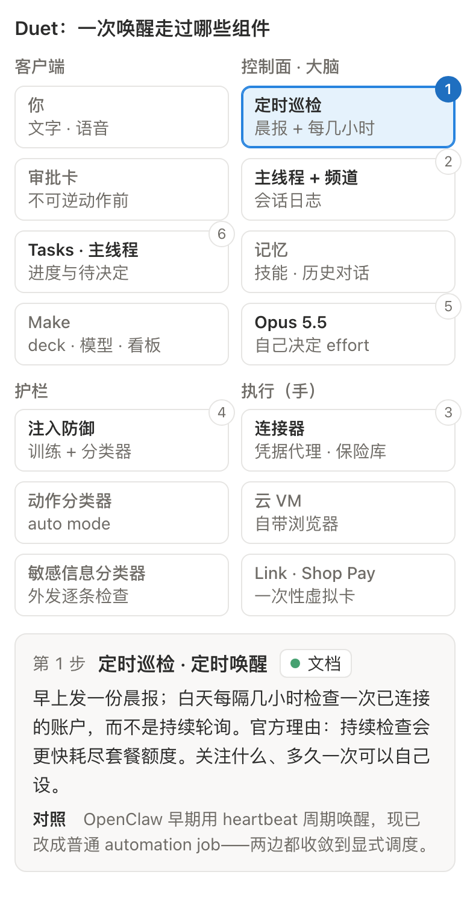

# 拆解 Claude Duet：一个会主动找你的 Claude

> 一句话判断：Claude Duet = 常驻云端 VM 的 Opus 5.5、每几小时一次的巡检，加一层「什么事值得打扰你」的判断器。引擎并不新，新的只有巡检节奏、打扰判断、外发信息审查和一次性虚拟卡支付。它押的不是功能广度，而是判断力和安全默认值。

10 月 21 日，Anthropic 发布 Claude Duet 的研究预览：一个独立 App（iOS / Android）加 claude.ai，不等你开口，它自己看邮件、盯账户、做调研、起草 deck，在要发信、要花钱、要删东西之前停下来问你[1][2]。发布时间挑在 Meta 财报日，媒体当天就把它定性为对 Meta Muse 和 OpenAI Dots 的回应[3]。

这篇文章拆三件事：Duet 到底由什么拼成；它和 Dots、Muse、Grok Bot、Manus Cue 差在哪；以及我最好奇的问题——常驻个人 Agent 这个形态，OpenClaw 年初就跑通了，大厂为什么直到现在才出手。

事实分三档：官方文档写明的给编号，我的工程判断标明「判断」，不确定的放进文末存疑清单。资料核对至 2026 年 10 月 26 日。

## 一、先看清它是什么

形态上，Duet 是一条主线程加若干主题频道。早上给你一份晨报，白天每隔几小时巡检一遍已连接的账户，任务在云端 VM 里跑，手机和电脑关机都不影响。主线程只推两类消息：「做完了」和「需要你定」[1][4]。招聘、融资、新店这类主题可以开频道，频道之间共享同一份记忆。

*官方演示三屏：晨报每条挂频道标签；Series A 频道里 deck 作为可编辑工件交付，并列着数据室还缺的三份文件；一句话就能生成从 POS、Shopify、CRM、工资单和银行取数的经营看板。*

官方的用户画像是专业人士和小企业主：招聘、融资、开店、催款、发工资[1]。负责人 Karan Ahuja 七月前还在 Meta 超级智能实验室做产品管理，八月加入 Anthropic 牵头 Duet[3]。官网的对比一句话讲完定位：Claude App 等你开口，Duet 主动来找你[5]。

商业上几个关键点：

- 预览期含在 Pro（20 美元/月）和 Max（100 美元/月起）里，不另收费，但和其他 Claude 产品共享 5 小时及每周额度——晨报和后台巡检按普通聊天同样的速率计数，大任务吃得更快[4]。
- 仅美国、仅 Pro / Max、仅等候名单分波放量。Team / Enterprise 只说「以后会有」，没有时间表；没有 Duet API，Mac 版在做[4][6][10]。
- 连接器继承账户已有的记忆、技能和应用，Marketplace 超过 6000 个插件；Slack 功能受限，Microsoft 365 暂不支持。断开应用只停后续访问，旧记忆保留[1][4]。
- 不打电话、不给别人发短信；经你批准可以用已连接账户发邮件[4]。

## 二、技术拆解：没有新原语，只有两处新东西

先给总判断：Duet 没有发明新的运行时原语。循环跑在 Managed Agents 式的无状态 harness 上，状态在会话日志里，手是按需拉起的云 VM，护栏是几类分类器加人审。真正新的只有两处——几小时一次的调度节奏外加「要不要打扰你」的判断，和逐条检查外发消息的信息流审查。

下图把一次唤醒经过的组件完整画了出来（博客版可交互，这里取静态图）：

*晨报巡检场景的组件图。四个泳道：客户端、控制面（大脑）、护栏、执行（手）。*

**大脑无状态，手按需拉起。** Managed Agents 四月的重构把一个 Agent 拆成三件：Session 是只追加的事件日志，Harness 是无状态循环，Sandbox 是执行环境；大脑和手解耦后，p50 首 token 延迟降约 60%，p95 降 90% 以上[8]。我的判断：Duet 每次巡检就是一次 wake——读日志、调连接器，只有要开浏览器或动文件时才拉起 VM，用完即停。几小时才醒一次的负载，为它常驻一台机器不划算。那篇工程文章开篇就叫「Don't adopt a pet」。

**会话不是上下文窗口。** 一条主线程可以无限长，因为会话日志是外部持久对象，harness 每轮按需取片段塞进上下文[8]。频道是给人看的分区，不是给模型的隔离——它们共享记忆正好说明上下文是每轮重新组装的。它给出的数字和摘要会注明出自哪封邮件、哪个文件、哪张表，检索层保留来源 ID，这是审计和纠错的前提。

**主动性的核心是一个打扰判断层。** 官方把 Duet 最有用的能力称为判断力：哪些事要找你、哪些可以等、什么时候先问你[1]。他们同时承认它可能读错线程、误判轻重缓急，校准还在继续[1][7]。

两个判断：第一，「几小时」首先是成本参数不是技术上限——用轮询换可预测的额度消耗，没有事件推送，急事可能落在两次检查之间。第二，分诊本质是给每条信号做四分类：要你 / 可以等 / 先动手 / 先问你。真正难的是推送阈值：打扰太多会被关通知，太少等于没用。这是 Duet 唯一全新的一层，也恰恰是唯一没有任何公开数据的一层。

发布日就有了第一批实测，评价两极：Every.to 的 Dan Shipper 用了两周，称它是第一个达到「pro tool」级别的个人 Agent[9]；产品人 Claire Vo 的标题却是《很漂亮，我还是忘了用它》——嫌它不够主动、有延迟、没有桌面端[11]。样本很小，但说明分水岭不在功能清单，在那个阈值调得准不准。

**凭据不进模型，浏览器是另一台机器。** 10 月 23 日的官方安全长文补充了关键细节：浏览器跑在独立云端 VM 上，和模型、agent 工作机都分开，agent 只能用 open / click / type 一组固定指令驱动它；网站代码、cookies、下载留在浏览器机，只有页面文本和下载文件回到模型，任何指令都读不出 cookies[7]。网站密码在设备端独立表单输入，用一次性密钥加密直达浏览器；登录表单永远不会以链接、短信、邮件形式出现——这本身就是钓鱼防御。Duet 的浏览器还带独立 User-Agent、公开出口 IP，上线前主动给大网站屏蔽选项，「有些网站选择屏蔽」[7]。

**安全栈是六层。** 输入层防邮件网页里藏的指令（Opus 4.5 加改进护栏后，自适应攻击者每环境试 100 次成功率 1.4%[12]）；动作层是跑在干活模型外面的外置分类器，页面里藏的指令影响不到它，在 Claude Code 上的真实数据是误拦 0.4%、漏放 17%[13]；信息流层是这次新加的独立分类器，分两级——登录凭据、完整卡号、证件号「永不外发，即使用户要求」，健康和财务信息需明确同意，被拦还能自动脱敏改写后再交你批[7]；然后是人审、硬禁区（证券交易、账户间转账、访问他人账户，批准也不做）、外部红队和 HackerOne 赏金。

三条判断：分类器是用来减少审批疲劳的，不是安全边界——17% 的漏放率说明它替代不了人审，所以不可逆动作留给人，最危险的类别直接禁；最值得抄的是 reasoning-blind，审查器看不到模型的自我辩解；信息流分类器是 Personal Agent 特有的一层——Coding Agent 的风险是做了不该做的事，替你读邮件的 Agent，风险是把 A 的信息发给 B。

**审批和支付做成卡片。** 你没空，它先做其余部分，审批稍后带回来。演示里的审批卡自带过期时间（8 分钟）——审批是一等状态，不是卡住整个任务的弹窗。支付两道确认：Duet 确认买什么，Link 批准花多少，然后发一张只对这一笔、这一个商家有效的虚拟卡，真实卡号既不给 Duet 也不给商家；也支持 Shop Pay[1][4]。责任边界第一次写进帮助文档：配送退货找商家，Link 扣款找 Link，Duet 选错东西找 Anthropic。

模型固定 Opus 5.5 不能换，每项工作花多少 effort 由它自己决定[4]。这颗模型 9 月 22 日发布时的卖点恰好是克制：行为审计最好、更少越界、Gray Swan 测试和 Fable 5.1 并列最低攻击成功率[14]。对常驻 Agent，克制比聪明值钱。

*左：开业清单里 640 美元卫生许可费的审批卡，写明金额、用途和「8 分钟后过期」。右：给投资人的邮件，收件人、主题、正文全部展开，确认后才发送。*

## 三、五个对手，分两派坐着

按 10 月下旬的公开功能，五家其实分成两派：

**「单助理、多会话」派——Duet、Muse、Dots。** 你经营的是和一个助理的长期关系。Duet 频道共享记忆；Muse 的主聊天和 side chats 上下文互通，9 月上线后四十天全球下载 1,090 万次（Sensor Tower 口径），Meta 财报披露美加约一千万人已设置、约四分之一日活[15][16]；Dots 一人一个 dot，后台有并行 agents，多 dot 被官方列为未来功能[17]。

**「多 Bot 团队」派——Grok Bot 和 Manus Cue。** 你管理一组有名字、有分工、会互相交接的 Bot。Grok Bot 支持 2 到 6 个 Bot 群聊，每用户一台可随时接管的 microVM，routine 最短 5 分钟，10 月 25 日马斯克又预告它能替你给商家打电话——Duet 明说不打的电话，边界正在被对手踩过去[18]。Cue 是邀请制，多个有身份的 agent 在同一频道接力，配有邮箱、手机号和钱包[19]。

价格带差别很大：Duet 20 美元的 Pro 就能用，Dots 个人最低 100 美元，Muse 基础版免费，Grok Bot 不单卖（X Premium 30 美元/月起附赠，注意不是网上流传的 120–200 美元旧价），Cue 内测免费但已出现 20 美元/月的 Plus 标签。

Duet 最像 Muse：一条主线加话题分区、上下文互通，只是定位偏工作，可以叫它「工作版 Muse」。它的优势是安全默认值最完整且每层都有公开工程文章、门槛低、冷启动快（记忆技能连接器直接继承）；短板也清楚：小时级轮询会漏急事，浏览器不能看不能接管，进不了 Slack 和 WhatsApp，只有美国 Pro / Max 能排队，而且没有任务级成本预估[6]。

## 四、OpenClaw 火了九个月，大厂为什么现在才出

我的结论：晚的不是想法，是可托管。OpenClaw 证明了需求，但把最难的部分甩给用户——自己的机器、自己的 key、自己的安全。大厂要过五道闸门。

**安全。** 今年一二月，公网可访问的 OpenClaw 实例不到一周从约一千涨到两万多（Censys 口径，截至 1 月 31 日）；SecurityScorecard 在 4.29 万个暴露面板里发现约 1.52 万个可被远程利用；研究员审计全部 2,857 个 ClawHub 技能，341 个恶意，其中 335 个来自 ClawHavoc 一次协同投毒；CVE-2026-25253 能从令牌外泄串到一键 RCE；到三月实例数接近 50 万，没有企业 kill switch[20][21][22]。凭据明文存放、执行工具前没有显式授权，是当时反复点名的架构问题。

**经济。** 常驻会打穿订阅。4 月 Anthropic 封禁用订阅驱动第三方 agent，理由是绕开 prompt cache、「很难可持续」；后来设计了独立计量、不结转的 Agent SDK 额度，又在生效当天暂停——「常驻怎么收费」至今没有一锤定音。需求端的账也不好看：OpenClaw 作者 Steinberger 自称上个月烧掉约一千万美元 token；大摩测算 Muse 单用户月服务成本约 3 到 130 美元，取决于用量[23][24]。Duet 的解法是不做持续在线，把巡检间隔本身变成产品参数。

**模型。** 托管方要为每一次越界负责。Anthropic 自己写过，早期模型不会在多个执行环境之间推理、不知道把活派到哪里[8]；即便现在，1% 量级的注入成功率仍被官方称为「有意义的风险」。所以要等行为审计过关的模型——9 月 22 日 Opus 5.5 发布，一个月后 Duet 亮相。

**基础设施。** Cowork 1 月上线，Managed Agents 4 月解耦，Claude Tag 6 月做出每线程临时沙箱和凭据代理，Cowork 10 月 6 日起新任务默认云端运行。积木到齐的时间点，差不多就是发布时间点。

**门禁。** 这是过去几个月新出现的一道：Muse 上线 12 天就被亚马逊屏蔽，Shopify 选择接入；沃尔玛同日发布 Agent Gateway，允许第三方 agent 代客购物但带额度和逐笔审批；国内豆包手机助手被 150 余款 App 拒之门外[25][26]。网站愿不愿意让你进门，和支付一样是基础设施问题。

触发器是竞争和人才。Grok Bot 8 月先发，Muse 四十天千万下载，Cue、Dots 九月底接连发布，Duet 10 月 21 日跟进。Sam Altman 二月亲自挖走 OpenClaw 作者去 OpenAI 做 personal agents；Meta 公开承认 Muse 受 OpenClaw 启发[27]。范式上 Duet 算 OpenClaw 的延续，架构上每一块都来自 Anthropic 自家此前的产品，差别最大的是默认值——OpenClaw 默认什么都能做，Duet 默认先问你，有些事批准了也不做。

顺带一句：Cowork 执行你交代的任务，Duet 先发现哪些事值得你关注，Tag 则是团队雇在 Slack 里的同事，用服务账号、花组织的钱。同一套「会话 / 大脑 / 手」分离的底座，三种委托关系。

## 五、做 Agent 的人，可以抄什么

- **通知是稀缺资源。** 「主线程只推完成和待决策」值得照抄，每条推送都要配得上一次打断；巡检频率既是产品参数，也是成本参数。
- **harness 无状态、从会话日志恢复，VM 只在需要浏览器或渲染时拉起，空闲即停。** 这是「大部分时间在睡」的 Agent 的标准答案。
- **护栏分三类各管一段：** 输入防注入、动作防越权、信息流防错发。会发帖、会发私信、会花钱的 Agent，第三层不能省。
- **审查器跑在模型外面，做 reasoning-blind；** 分类器只负责减少打扰，发布、付费、删除仍然人审，最危险的类别直接禁掉，而且不提供「以后别问」。
- **审批是一等状态：** 带金额、用途、过期时间，可以延后处理，过期显式上报。
- **主动声明身份：** 独立 User-Agent、公开出口 IP、给站点屏蔽选项，是 agent 进入开放网络的入场费。

## 还没答案的问题

研究预览阶段，这些问题公开材料回答不了：「每几小时」到底是几小时、能否按连接器设置；打扰判断的准确率和信息流分类器的误拦率；17% 的动作漏放率能否代表邮件和付款场景；Pro 额度实际能撑多久；巡检读到的邮件和银行数据保留多久、是否用于训练（官方只讲删除、不讲保留期限）；以及 Duet 和 Cowork、Tag 最终会不会合并。

公众仍在排队，实测评价两极。这份拆解基于官方材料、工程旁证和已发布的第三方报道——每个「判断」都欢迎在更大样本出来后回来推翻。

## 参考资料

产品信息核对日期：2026 年 10 月 26 日。以下为主要资料，地址可复制。

[1] Anthropic · Introducing Claude Duet

https://claude.com/resources/articles/claude-duet

[2] CNBC · Anthropic previews Claude Duet

https://www.cnbc.com/2026/10/21/anthropic-preview-of-claude-duet-personal-ai-agent-take-on-muse-dots.html

[3] Business Insider · Anthropic answers Meta and OpenAI with Claude Duet

https://www.businessinsider.com/anthropic-answers-meta-openai-new-personal-agent-claude-duet-2026-10

[4] Claude Help · Get started with Claude Duet

https://support.claude.com/en/articles/17631495-get-started-with-claude-duet

[5] Claude Duet 产品页

https://claude.com/product/claude-duet

[6] VentureBeat · Anthropic's answer to Muse is here

https://venturebeat.com/technology/anthropics-answer-to-muse-is-here-claude-duet-a-mobile-and-desktop-ai-agent-that-takes-actions-proactively

[7] Anthropic · Claude Duet Safety, Privacy, and Security（10 月 23 日）

https://claude.com/resources/articles/claude-duet-safety-privacy-and-security

[8] Anthropic · Scaling Managed Agents

https://www.anthropic.com/engineering/managed-agents

[9] Every.to · Vibe Check: Duet, Anthropic's always-on agent

https://every.to/vibe-check/vibe-check-duet-anthropic-s-always-on-agent

[10] Karan Ahuja · Duet waitlist FAQ

https://x.com/ahuja_karan/status/2113768265562620109

[11] Lenny's Newsletter · Claire Vo：Claude Duet is beautiful. I still forgot to use it

https://www.lennysnewsletter.com/p/claude-duet-is-beautiful-i-still

[12] Anthropic · Mitigating prompt injections in browser use

https://www.anthropic.com/research/prompt-injection-defenses

[13] Anthropic · How we built Claude Code auto mode

https://www.anthropic.com/engineering/claude-code-auto-mode

[14] Anthropic · Introducing Claude Opus 5.5

https://www.anthropic.com/claude-opus-5-5

[15] TechCrunch · Meta's Muse hits 10M U.S. downloads in 40 days

https://techcrunch.com/2026/10/20/metas-muse-hits-10m-u-s-downloads-in-40-days-a-milestone-reached-by-only-11-other-apps

[16] CNBC · Meta Q3 财报与 Muse 数据

https://www.cnbc.com/2026/10/22/meta-muse-personal-ai-agents.html

[17] OpenAI · Introducing Dots

https://openai.com/index/introducing-dots

[18] xAI · Grok Bot Changelog

https://x.ai/changelog/bot

[19] Manus · Introducing Manus 2.0

https://manus.im/blog/introducing-manus-2-0

[20] Acronis · OpenClaw: agentic AI in the wild（引 Censys 数据）

https://www.acronis.com/en-us/tru/posts/openclaw-agentic-ai-in-the-wild-architecture-adoption-and-emerging-security-risks/

[21] SC Magazine · 341 malicious ClawHub skills（Koi Security 审计）

https://www.scmagazine.com/news/openclaw-agents-targeted-with-341-malicious-clawhub-skills

[22] VentureBeat · OpenClaw: 500,000 instances, no enterprise kill switch

https://venturebeat.com/security/openclaw-500000-instances-no-enterprise-kill-switch

[23] VentureBeat · Anthropic reinstates OpenClaw and third-party agent usage, with a catch

https://venturebeat.com/technology/anthropic-reinstates-openclaw-and-third-party-agent-usage-on-claude-subscriptions-with-a-catch

[24] The Dark Side of the Boom · Morgan Stanley: Muse has to earn the economics

https://thedarksideoftheboom.substack.com/p/morgan-stanley-meta-has-built-the

[25] Business Insider · Walmart adds AI agent shopping while Amazon blocks bots

https://www.businessinsider.com/walmart-adding-ai-agent-shopping-features-while-amazon-blocks-bots-2026-10

[26] 36 氪 · 没几个 App 愿意给 AI 助手开门

https://m.36kr.com/p/4036677968057223

[27] TechCrunch · Meta admits Muse's likeness to OpenClaw

https://techcrunch.com/2026/09/22/meta-admits-muses-likeness-to-openclaw-isnt-a-coincidence
